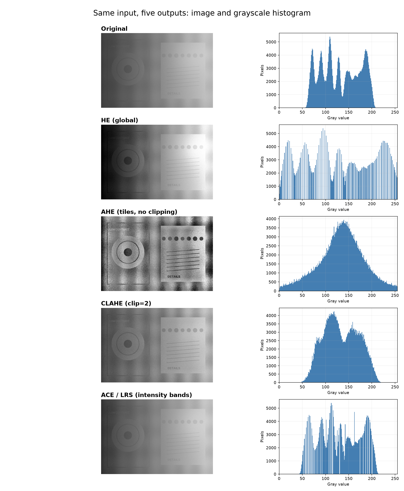
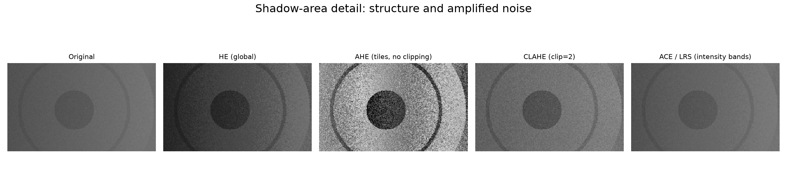
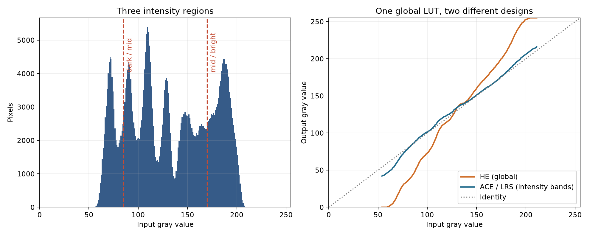

# HE、AHE、CLAHE 与自适应局部区域伸展：原理、优缺点和 OpenCV 实战

> 同一张偏暗、照明不均的图，为什么有的算法能看清暗部，却把噪声也变成了“纹理”？关键不是把直方图画得更平，而是弄清楚**映射依据来自整张图、空间邻域，还是某段灰度范围**。

本文讨论 **8 位灰度图**（灰度值 0～255）。示例图为本文代码固定随机种子生成的模拟检测场景，包含左侧阴影、右侧较亮区域、低对比度圆环/细线和少量随机噪声；它不是实拍图，也不能代表所有图像。四种方法与原图使用完全相同的输入和显示灰度范围。



## 1. 先理解直方图、CDF 与“拉开灰度”

直方图 `h(k)` 记录灰度 `k` 有多少像素；`N` 是总像素数。累计分布函数（CDF）为：

```text
p(k)   = h(k) / N
CDF(k) = Σ[j=0..k] p(j)
```

CDF 永远不下降。若某段灰度像素很多，CDF 在那里上升快；若像素很少，上升慢。把 CDF 当作输入到输出的灰度映射，就会**拉开高频灰度段、压缩低频灰度段**。例如原图多数像素挤在 100～120，HE 会给这 21 个输入灰度分配更宽的输出范围，局部差异更容易看见；那里若主要是噪声，噪声也会一起被拉开。

对 8 位图，常见的离散 HE 表达式是：

```text
T(k) = round[255 × (CDF(k) - CDFmin) / (1 - CDFmin)]
```

`CDFmin` 是第一个非零直方图箱对应的 CDF，用来让实际出现的最低灰度接近 0。若全图只有一个灰度值，分母为零，必须单独处理。不同库的取整和边界处理可能略有差异。**均衡化也不保证输出直方图严格平坦**：灰度是离散的，多个像素会落到同一个输出箱，有些箱会为空。[OpenCV 的 HE 教程](https://docs.opencv.org/4.x/d5/daf/tutorial_py_histogram_equalization.html)给出了 CDF 与 `equalizeHist` 的实现。

一个容易混淆的参照物是线性拉伸：

```text
Tlinear(k) = 255 × (k - a) / (b - a)，再截断到 [0,255]
```

其中 `a,b` 可以取最小/最大灰度，也可以取百分位数。它对区间内灰度使用**固定斜率**；HE 的斜率随直方图变化。线性拉伸不等于直方图均衡化。[OpenCV 的线性对比度教程](https://docs.opencv.org/4.x/d3/dc1/tutorial_basic_linear_transform.html)说明了增益、偏置与饱和截断。

## 2. HE：整图共用一张映射表

**Histogram Equalization（全局直方图均衡化）**先统计整张图，再生成一张 256 项查找表（LUT），每个像素按自身灰度查表。相同输入灰度无论位于左上角还是右下角，输出都相同。

```text
整张图 → 一份直方图 → 一条 CDF 曲线 → 一张 LUT → 输出图
```

**优点：**实现简单、速度快、不需设置窗口大小；当整图灰度集中且照明较一致时，能迅速扩展整体动态范围。OpenCV 直接调用 `cv.equalizeHist(gray)`。

**缺点：**阴影区和亮区争用同一条映射曲线，未必都获得合适的局部对比度；大面积背景会主导统计；亮度外观可能明显改变，噪声和量化台阶也可能被强调。它只能重新分配已有灰度，不能恢复过曝、欠曝或失焦丢失的信息。

**直观理解：**全班共用一套成绩排名。某一个班级的分数分布会影响所有人的“名次映射”，但它不关心谁坐在光线较暗的角落。

## 3. AHE：每个位置参考附近的统计

**Adaptive Histogram Equalization（自适应直方图均衡化）**为不同空间位置使用不同的局部直方图与 CDF。经典定义可为每个像素取一个滑动邻域，计算局部 LUT；工程实现常把图像分成网格小块（tiles），对每块求 LUT，再对相邻块的映射结果做双线性插值，以避免硬块边界。[Pizer 等人的 AHE 原论文](https://doi.org/10.1016/S0734-189X(87)80186-X)讨论了 AHE 及其变体。

```text
空间邻域/网格块 → 各自直方图与 LUT → 邻块之间插值 → 输出图
```

同样的输入灰度，落在阴影块和亮块时可能输出不同，因为它们周围的灰度分布不同。本文代码的 `ahe_tiled()` 是**分块加插值的 AHE 近似**：借用 OpenCV 的 CLAHE 实现，把剪裁阈值设到对 8 位块直方图实际上不会触发剪裁的程度。它不冒充逐像素滑窗 AHE。

**优点：**对一张图中同时存在的阴影和明亮区域更有针对性；微弱局部边缘通常比全局 HE 更容易显现。**缺点：**均匀区域只有少量噪声时，局部 CDF 也会努力“铺满”灰度范围，导致颗粒、压缩伪影甚至暗角被夸张；网格越细越敏感，计算和内存成本也高于 HE。



放大图里，AHE 的圆环更醒目，但原先弱小的随机颗粒也变得密集。**边缘变清楚与信息变准确不是同一件事。**

## 4. CLAHE：给局部放大设置上限

**Contrast Limited AHE（限制对比度的自适应直方图均衡化）**沿用局部网格与插值，在计算每块 CDF 前，把直方图过高的箱剪裁，并将多出的计数分摊回各灰度箱。这样可限制 CDF 在单个高峰处的陡峭程度，从而抑制 AHE 对均匀区域噪声的过度放大。OpenCV 的教程也说明了分块、剪裁与双线性插值。[OpenCV 的 CLAHE 教程](https://docs.opencv.org/4.x/d5/daf/tutorial_py_histogram_equalization.html)

```text
每块直方图 → 限制高峰并分配多余计数 → 各块 CDF/LUT
                                          → 邻块插值 → 输出图
```

OpenCV 调用示例：

```python
clahe = cv2.createCLAHE(clipLimit=2.0, tileGridSize=(8, 8))
result = clahe.apply(gray)
```

这里的 `(8, 8)` 是**横向 8 块、纵向 8 块**，并不是每块只有 `8×8` 像素。`clipLimit=2.0` 是 OpenCV API 使用的归一化参数，不能简单读成“每个灰度箱最多两个像素”。在 8 位实现里，内部阈值与块面积及 256 个灰度箱有关；阈值越大，效果越接近不剪裁的 AHE。[OpenCV `createCLAHE` 参数说明](https://docs.opencv.org/4.x/d6/dc7/group__imgproc__hist.html)

**优点：**在照明不均时兼顾局部细节与噪声控制；实现成熟，参数少。**缺点：**它只是限制放大，不能消灭噪声；网格太密或 `clipLimit` 太大仍会有颗粒、局部不自然与接缝风险；网格太粗、阈值太小则可能看不出改善。细小真实缺陷与细小噪声很像，不能仅凭视觉“平滑”判断参数好坏。

## 5. 自适应 Local Region Stretch：这里的“区域”是灰度区域

这里按 Srinivasan 与 Balram 的 *Adaptive Contrast Enhancement Using Local Region Stretching* 理解。论文将亮度直方图按**灰度范围**分为暗、中、亮三段，各段独立进行 HE，然后把各段结果与原像素按权重混合。权重由该段灰度的“伪方差”决定：论文实际使用的是**平均绝对偏差**（MAD），并让分布极窄或极分散的区域获得较小 HE 权重，以缓和过度增强。暗段通常允许较强处理，中段次之，亮段较弱。[Srinivasan 与 Balram 原论文 PDF](https://www.iitk.ac.in/asid06/proceedings/papers/TB2_3-C.pdf)

```text
整张图的灰度轴：[  暗 0～84  |  中 85～169  |  亮 170～255  ]
                      ↓             ↓                ↓
                 各段独立 HE    各段独立 HE       各段独立 HE
                      └──── 依据各段 MAD 调整权重 ────┘
                              与原图混合得到一张 LUT
```

对一段 `r`，可写作：

```text
μr   = Σ[k∈r] k × h(k) / Nr
MADr = Σ[k∈r] |k - μr| × h(k) / Nr
Tout(k) = (1 - wr) × k + wr × THE,r(k)，k∈r
```

`THE,r` 为该灰度段内的均衡化映射，`wr` 随 MAD 和所处暗/中/亮段改变。原论文给出了权重随离散程度变化的三角形示意及设计原则，但没有提供一套可直接复制的通用固定参数。本文 `ace_lrs()` 明确选用三等分灰度段、三角形 MAD 权重和 `(0.95, 0.65, 0.35)` 的最大强度，作为**论文思想的教学实现**，不声称逐像素复刻论文硬件结果。



**最重要的区别：**这个 Local Region 指的是暗/中/亮**灰度段**，不是 AHE 的图像空间小块。同一灰度值在不同位置仍使用相同的输出 LUT。它的“局部效果”是只处理某些亮度层次，无法像 CLAHE 那样对同一灰度在不同空间位置分别增强。

**优点：**可偏重暗部并尽量少动亮部；权重能抑制一部分极端直方图造成的伪影；只需一张全图 LUT，便于实时视频处理。**缺点：**效果依赖分段边界与权重设计；灰度段边界可能出现斜率突变或色调台阶；不同位置但相同灰度的问题仍无法区分；按帧重算参数的视频还需要考虑闪烁与时间平滑。

## 6. 放在一起比较

| 方法 | 统计范围 | 同灰度、不同位置能否不同输出 | 噪声风险 | 主要参数 | 适合先试的场景 |
| --- | --- | --- | --- | --- | --- |
| HE | 整张图 | 否 | 中～高 | 基本无 | 照明较均匀、整体灰度挤在窄区间 |
| AHE | 空间邻域/网格 | 能 | **高** | 邻域或网格大小 | 极需局部细节且输入噪声低 |
| CLAHE | 空间网格 | 能 | 受剪裁控制，仍存在 | 网格数、`clipLimit` | 阴影与亮区共存，想抑制 AHE 过增强 |
| ACE/LRS | 全图的暗/中/亮灰度段 | 否 | 取决于各段权重 | 分段边界、权重曲线 | 想有选择地处理暗部并保持较温和外观 |

这张表说的是各自**如何统计并生成映射**，不是无条件的质量排名。图像增强应针对后续任务比较，例如 OCR 正确率、缺陷检出率、误检率或测量边缘偏移；输出直方图更宽、图片更“通透”，都不能单独证明算法更好。

## 7. 运行代码与复现图片

环境建议 Python 3.10+。仓库中的 [`enhance.py`](enhance.py) 包含四种方法、输入检查和命令行入口；[`generate_figures.py`](generate_figures.py) 生成原始模拟图与本文三张对比图。示例不依赖外部图片下载。

```bash
python -m pip install -r requirements.txt
python generate_figures.py
python enhance.py assets/synthetic_input.png --output output
```

核心调用只有几行：

```python
import cv2 as cv
from enhance import he, ahe_tiled, clahe, ace_lrs

gray = cv.imread("your_image.png", cv.IMREAD_GRAYSCALE)
if gray is None:
    raise FileNotFoundError("your_image.png")

out_he = he(gray)
out_ahe = ahe_tiled(gray, grid=(8, 8))
out_clahe = clahe(gray, clip_limit=2.0, grid=(8, 8))
out_lrs = ace_lrs(gray)
```

如果输入是彩色图，通常先转换到将亮度与颜色分开的空间，**只处理亮度**，再转回 BGR。以下是简短示例；颜色可能仍因亮度变换和色域截断而轻微改变，需要对照原图检查。

```python
bgr = cv.imread("color.png", cv.IMREAD_COLOR)
if bgr is None:
    raise FileNotFoundError("color.png")
ycrcb = cv.cvtColor(bgr, cv.COLOR_BGR2YCrCb)
y, cr, cb = cv.split(ycrcb)
y2 = clahe(y, clip_limit=2.0, grid=(8, 8))
result_bgr = cv.cvtColor(cv.merge((y2, cr, cb)), cv.COLOR_YCrCb2BGR)
cv.imwrite("color_clahe.png", result_bgr)
```

OpenCV 的 `equalizeHist` 处理单通道 8 位输入；`CLAHE.apply` 支持单通道 8 位或 16 位输入，但本文 AHE/ACE 示例和图示只针对 8 位。对医学影像、工业相机原始 12/16 位数据，先弄清有效位深、黑电平及是否已经做过 Gamma/自动增益，不要随手转成 8 位造成不可逆的信息损失。[OpenCV `equalizeHist` 与 `CLAHE` API](https://docs.opencv.org/4.x/d6/dc7/group__imgproc__hist.html)

## 8. 参数如何选，什么时候不要用

1. **先看原图是否已截断。**大面积纯黑/纯白、运动模糊、失焦，都不能靠直方图变换找回细节。采集端可调时，先检查曝光、光源和增益。
2. **先固定评价区域与任务指标。**同一套参数在暗部改善的同时可能增加背景误检；请同时比较目标区域、均匀背景和亮部。
3. **CLAHE 从温和设置开始。**`grid=(8,8)`、`clipLimit=2.0` 是本文演示值，不是通用最优；提高块数会缩小空间尺度，提高剪裁阈值会允许更强局部增强。
4. **不要把 AHE 的“细节多”误认为信息多。**可用本文的阴影放大图检查噪声，必要时结合采集降噪或轻度预处理，但别抹掉真正的细线缺陷。
5. **视频需要额外检查时序。**逐帧映射随画面内容变化可能闪烁，须考虑统计平滑及帧间一致性。

## 参考资料与图片说明

- [OpenCV：Histogram Equalization 教程](https://docs.opencv.org/4.x/d5/daf/tutorial_py_histogram_equalization.html)：HE 与 CLAHE 概念及 Python 调用。
- [OpenCV：直方图处理 API](https://docs.opencv.org/4.x/d6/dc7/group__imgproc__hist.html)：`equalizeHist`、`createCLAHE` 参数。
- [Pizer et al., *Adaptive Histogram Equalization and Its Variations*, 1987](https://doi.org/10.1016/S0734-189X(87)80186-X)：AHE 原论文。
- [Srinivasan & Balram, *Adaptive Contrast Enhancement Using Local Region Stretching*, 2006](https://www.iitk.ac.in/asid06/proceedings/papers/TB2_3-C.pdf)：暗/中/亮灰度段处理、MAD 自适应权重。

本文三张解释/对比图及模拟输入均由本仓库代码生成，没有转载上述论文或其他网页的图片。手动发布到知乎时，请把 Markdown 中的三张 PNG 分别上传到知乎编辑器并替换本地相对路径；仅粘贴 `assets/...` 路径不会自动把图片上传。
